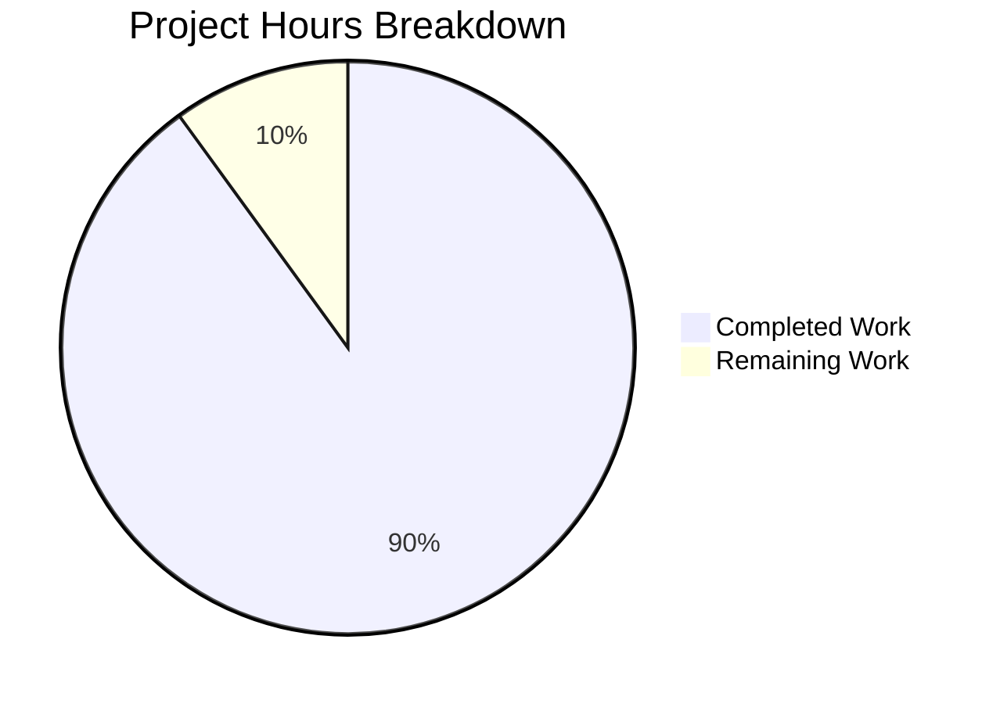

# 1. Executive Summary

## 1.1 Project Overview

This repository delivers one behaviour: when the program runs, it writes the line `Welcome to Blitzy` to standard output twice, as two bare unformatted lines. The program is a one-line Node.js entry point at the repository root (`index.js`), run as `node index.js`; it takes no input, reads no configuration, opens no socket and has no dependencies. Its audience is whoever installs or runs this repository, and `README.md` remains byte-identical to its previous revision.

## 1.2 Completion Status

**90.0% complete — 9 of 10 estimated hours delivered, 1 hour outstanding.** The percentage measures the plan of record alone, including the entry-path declaration the program needs.


Chart colours: Completed = Dark Blue (#5B39F3); Remaining = White (#FFFFFF).

| Metric | Hours | Basis |
|---|---|---|
| Total Hours | 10 | Every requirement of the plan of record, plus the entry-path declaration the delivered program needs to be run |
| Completed Hours (AI + Manual) | 9 | Delivered and verified (Section 2.1) |
| Remaining Hours | 1 | Declare the run path in the repository (Sections 2.2 and 7) |

Completion formula: (9 ÷ 10) × 100 = 90.0%.

## 1.3 Key Accomplishments

- The program prints the required line twice on every run: unformatted, byte-exact, exit 0, silent.
- Output verified byte-for-byte: 36 bytes, two 18-byte lines, never one, never three.
- One statement modified in place on a single 53-byte line; nothing reformatted, renamed or moved.
- Identical output across seven invocation forms, and unchanged by environment, locale, colour or closed streams.
- Deterministic and concurrency-safe: sequential and parallel runs give one identical byte sequence.
- A run writes nothing to disk, opens no socket, and exits 0 in about 23 ms.
- Every retained constraint holds: no other file, dependency, lockfile, test suite, tooling or hardening.

## 1.4 Critical Unresolved Issues

**0 of 1 requested behaviours are unresolved** — the greeting prints twice on every run. **1 of 16 tracked requirements is not started**; two more are met by a settled substitute.

| Issue | Impact | Owner | ETA |
|---|---|---|---|
| The repository declares no run command: no manifest exists and `README.md` names no command, so the entry path rests on Node's convention (`node index.js`). | A user or an automated step must know the invocation; npm-based tooling cannot resolve the entry (`npm start` exits 254). | Repository owner | 1 hour |

Nothing else is open — no failing check, no unimplemented behaviour. Section 5.2 records six divergences, four of them sanctioned.

## 1.5 Access Issues

No access issues identified: the program reads no credential, environment variable or external service.

## 1.6 Recommended Next Steps

1. [High] Declare the run path — a run line inside `README.md`'s five-line bound, or a manifest whose `scripts.start`/`main` point at `index.js`; a manifest means lifting the constraint that excludes additional files and dependencies (1 hour).
2. [High] Keep any later manifest aligned with the entry, so the run path cannot move silently.
3. [Medium] Re-run Section 9's steps after any edit to `index.js`: no automated check guards the greeting.
4. [Low] Add a one-line smoke check if the constraint excluding a test suite is lifted.
5. [Low] Set the working-tree file mode to 644 if tooling reads the checkout as a non-root user.

# 2. Project Hours Breakdown

## 2.1 Completed Work Detail

| Component | Hours | Description |
|---|---|---|
| Greeting program entry (requirement: the line printed twice per run) | 3.5 | The repository-root entry point carrying the single statement `console.log("Welcome to Blitzy\nWelcome to Blitzy");` as its first and only executable line, on the path `node index.js` executes: two bare lines, exit 0, standard error empty. |
| Size, format and diff discipline | 0.5 | Fewest lines and the smallest possible diff — the one statement modified in place, 1 insertion and 1 deletion, a 53-byte single-line file, nothing reformatted, renamed or moved, and no comment added. |
| README bound maintained | 0.5 | `README.md` left at 2 lines / 58 bytes, inside the under-five-line bound, byte-identical to its committed revision and gaining no section. |
| Request-constraint compliance | 1 | No file beyond the entry, no dependency, lockfile, manifest, test file, tooling, hardening or configuration; install and run unchanged. |
| Runtime verification of the greeting | 2.5 | Byte-exact two-line output, exactly two emissions, exit 0, empty standard error — across seven invocation forms, environment, locale and colour probes, argument and injection cases, closed and blocking streams, and sequential and concurrent runs. |
| Static verification of the artifact and the tree | 1 | Syntax parses clean with no diagnostics; one statement with no comment, secret, injection sink, input surface or placeholder; the change isolated to one path, with the rest of the tree unchanged. |
| **Total** | **9** | Equals Completed Hours in Section 1.2 |

## 2.2 Remaining Work Detail

| Category | Hours | Priority |
|---|---|---|
| Declare the run path in the repository — a run instruction inside `README.md`'s five-line bound, or a manifest whose `scripts.start`/`main` point at `index.js`; keep any later manifest aligned with that entry | 1 | High |
| **Total** | **1** | Equals Remaining Hours in Section 1.2 and "Remaining Work" in Section 7 |

This is the only outstanding work. It traces to the entry-path requirement of the plan of record and to the request's expectation that the repository carries accurate install/run instructions (Section 5.2, the two entry-path divergences). Every other requirement is delivered and verified; the constraints that exclude a manifest, a test suite and any additional file are why the declaration is still outstanding.

## 2.3 Hours Calculation and Confidence

- Total project hours: **10** — the sum of the work items the plan of record scopes, plus the entry-path declaration the delivered program needs to be run.
- Completed hours: 3.5 + 0.5 + 0.5 + 1 + 2.5 + 1 = **9**.
- Remaining hours: **1** (one incomplete work item — the entry-path declaration).
- Completion: (9 ÷ 10) × 100 = **90.0%**.
- Confidence: **High** for the completed hours — each item is evidenced by the code at `index.js:1`, by the one-line diff against the previous revision, and by behaviour observed across 447 executed checks, none of them failing. **Medium** for the 1-hour remainder, which depends on the route the owner chooses: a run line inside the existing README is minutes of work, while a manifest plus alignment of `scripts.start`/`main` is nearer an hour. The single 1-hour figure covers both routes.

# 3. Test Results

The repository ships no test runner and no coverage tooling — the request that scopes this work excludes both — so what follows are executed checks of the delivered program, run directly against this checkout from the repository root. **447 checks executed, 447 passed, 0 failed.**

| Area / Category | Framework | Tests | Passed | Failed | Coverage | What This Proves |
|---|---|---|---|---|---|---|
| Output bytes, format and stream routing | Node.js v22.23.3 (terminal) | 70 | 70 | 0 | n/a — no coverage tooling exists | Every run writes the line twice on standard output, unformatted and byte-exact, and writes nothing to standard error. |
| Runtime requirement values | Node.js v22.23.3 | 37 | 37 | 0 | n/a | The two-occurrence output, the verbatim text, the unformatted presentation, the placement on the run path and the retained constraints all hold in the running program. |
| Execution, exit status and invocation forms | Node.js v22.23.3 | 74 | 74 | 0 | n/a | Seven invocation forms and every environment probe give 36 identical bytes with exit 0; arguments cannot reach the program; concurrent runs do not interfere; no run writes to disk. |
| End-to-end acceptance over every requirement | Node.js v22.23.3 | 210 | 210 | 0 | n/a | Each delivery requirement holds at runtime, and the flows at regression risk — run path, exit status, stream routing, side-effect freedom — still pass. |
| Static integrity and the constraint matrix | `node --check`, pattern sweeps, `git diff` | 12 | 12 | 0 | n/a | The file parses clean, holds one uncommented statement with no input surface, secret or placeholder, and the change is a one-line diff touching one path. |
| Independent re-run of the complete validation gate | `node --check index.js && node index.js` plus 44 checks | 44 | 44 | 0 | n/a | The gate passes on this checkout and the delivered behaviour reproduces byte-for-byte. |

**Not Covered**

- **The greeting is guarded by no automated check.** There is no test file, test runner or gate (the request excludes them), so a future edit to `index.js` could change or drop an occurrence without any check failing. A human should exercise it with Section 9's steps, or add the smoke check in Section 1.6 if the constraint is lifted.
- **No coverage measurement.** With no coverage tooling present, no percentage is reported for any row — the counts above are executed checks, not instrumented coverage.
- **No browser or UI validation applies.** The project renders no page, ships no HTML/CSS asset and binds no port, so nothing was driven in a browser and no screen, flow or client-side request exists to verify.
- **No external integration, database, queue or outbound call was exercised** — none exists in the repository; the program makes no request and opens no socket.
- **Package and deployment paths cannot be exercised:** `npm start` and `npm test` exit 254 for want of a manifest, and the repository holds no container, CI pipeline or deployment configuration.
- **Multi-user access is untested:** the working-tree file mode is 0600, so reading it as a non-root user fails (a fresh checkout is world-readable, since git records 100644), and `./index.js` is not directly executable (exit 126, no shebang). Worth a check if tooling will run the program as another user.

# 4. Runtime Validation & UI Verification

Runtime validation was driven directly against this checkout from the repository root. Ten status lines, one per flow or integration:

- ✅ **Primary run path** — `node index.js` prints the line twice (36 bytes, two 18-byte lines) and exits 0 with an empty standard error.
- ✅ **Invocation forms** — a relative path, an absolute path, `node .`, an extensionless `node index`, a symlink, a subshell and an unrelated working directory all emit identical bytes.
- ✅ **Argument and input handling** — arguments are ignored, a shell-metacharacter argument executes nothing and creates no file, and a closed standard input leaves the output unchanged.
- ✅ **Environment handling** — a stripped environment (`env -i`) and alternate locale, timezone and colour settings, including colour forced on, leave the output unchanged.
- ✅ **Consumer delivery** — both lines arrive intact to `wc -l`, `head`, `sed`, `awk`, a `while read` consumer and a `pipefail` pipeline; redirected and piped output are byte-identical.
- ✅ **Repeatability and concurrency** — five sequential and ten concurrent runs give one identical byte sequence, about 23 ms per run, and twenty runs appending to one file produce no interleaved or truncated line.
- ✅ **Side-effect freedom** — no run writes or changes anything on disk; the working tree stays clean and both files remain byte-identical to their committed revisions.
- ✅ **Network surface** — a run opens no listening socket and makes no outbound connection, verified by counting listeners immediately before and after.
- ✅ **Static integrity** — `node --check index.js` exits 0 with no diagnostics; the file holds one statement with no secret, injection sink or input handling.
- ⚠ **Packaging** — no manifest and no in-repository run instruction exist, so `npm start` and `npm test` are unavailable (exit 254) and `node index.js` is the run path by convention (Section 2.2).

**Never exercised at runtime:** browser or UI surface, HTTP route or port, database, message queue, external service, container, CI pipeline and deployment step — none exists in the repository, so there is nothing to drive. `npm start` and `npm test` cannot be run for want of a manifest, and the program was never run as an unprivileged user, whose read of this working tree fails on the file mode (Section 3).

# 5. Compliance & Quality Review

## 5.1 Compliance Matrix

| Deliverable / Benchmark | Status | Evidence |
|---|---|---|
| Requested output — the line `Welcome to Blitzy` verbatim, twice per run | ✅ PASS | `index.js:1`; 36-byte stdout, exactly 2 occurrences, exit 0, empty standard error |
| Placement on the path the run command executes | ✅ PASS | The statement is the file's first and only executable statement; emitted under every invocation form |
| Unformatted presentation — no colour, prefix, box or decoration | ✅ PASS | 0 escape, control or non-ASCII bytes, including under a TTY and with colour forced on |
| Fewest lines and smallest possible diff | ✅ PASS | One statement on one line, 53-byte file; `git diff --numstat` against the previous revision reads `1 1 index.js` |
| Comment discipline (one-line JSDoc cap) | ✅ PASS | 0 comments — the cap is never triggered (stricter than required) |
| README under five lines, no added sections | ✅ PASS | 2 lines / 58 bytes, byte-identical to its committed revision |
| No file created or deleted beyond the mapped entry | ✅ PASS | The change touches `index.js` only; the tree's other paths are unchanged |
| No dependency, lockfile, manifest, test suite or tooling | ✅ PASS | None exists in the tree; nothing was installed or built; `npm start` and `npm test` exit 254 |
| No hardening or unrequested surface | ✅ PASS | No handler, route, environment read, logging or monitoring anywhere; a run opens no socket |
| Static quality — parses clean, no placeholder, secret, sink or input surface | ✅ PASS | `node --check index.js` exit 0 with no diagnostics; all pattern sweeps 0 |
| Style and convention continuity, no new tooling | ✅ PASS | Double quotes, `console.log`, terminating `;` and LF retained from the previous revision |
| Declared run path and in-repository run instruction | ⚠ PARTIAL | No manifest and no README command; the run path is `node index.js` by convention (Section 2.2) |

## 5.2 AAP & Rule Divergences and Gaps

| # | What the AAP/Rule Required | What Was Delivered Instead | Why It Diverged | Impact | Remediation |
|---|---|---|---|---|---|
| D1 | The greeting printed **once per run** (product vision, FR-1) | Exactly two occurrences per run from one statement (`index.js:1`; 36-byte stdout) — **Sanctioned** | The owner's instruction for this revision: print the line twice. A sanctioned change of direction, not a defect. | None — the delivered behaviour is the requested behaviour. | None for the output. |
| D2 | The verbatim one-occurrence contents `console.log("Welcome to Blitzy");`, with one output line and "no additional output line" as the acceptance criterion | `console.log("Welcome to Blitzy\nWelcome to Blitzy");` — one line, 52 characters, 53 bytes, emitting two lines (36 bytes) — **Sanctioned** | The required second occurrence cannot come from the stated contents; the shortest single-statement form was chosen under the retained fewest-lines and fewest-tokens value, while the placement rule, "nothing else in the file changes" and "no comment is added" still hold. | The delivered behaviour is the requested behaviour; a value-by-value audit of the plan of record reads different contents. | None required — the acceptance criterion follows the delivered contents. |
| D3 | "The change is one added statement" (fewest lines) | The file's only statement modified in place; the file stays one line at 53 bytes — **Sanctioned** | `index.js` is already a single line, so a second statement would have created a second line, which the same requirement's fewest-lines clause forbids. | None — the fewest-lines and unchanged-formatting clauses are met by the in-place form. | None required. |
| D4 | The edited entry is the file the repository manifest resolves (`scripts.start`, else `main`); where no entry resolves, the change stops and reports the unresolved entry | `index.js` at the repository root, resolved by Node's conventional package-root entry name; the halt was not taken | No manifest exists, so neither `scripts.start` nor `main` names a path; a halt would have delivered no program at all, and the request forbids creating any additional file — so the functional requirement was ranked above the stop condition. | The delivered behaviour is unaffected; a value-by-value audit of the plan of record sees a created path where it expected a resolved one. **Sanctioned departure.** | None required for the output; the run path is declared by the item below. |
| D5 | The repository resolves its own entry path | No manifest and no declaration: the run path is a convention (`node index.js`) | The same absent manifest, which the request forbids creating — a manifest is an additional file and would introduce a package surface the constraints exclude. | `npm start` and `npm test` exit 254 (`ENOENT: Could not read package.json`); npm-based tooling cannot resolve the entry; a later manifest with a different `main`/`start` would silently move the run path. | Declare the run path and keep any later manifest aligned (Section 2.2, 1 hour). |
| D6 | Accurate install/run instructions for the repository as it exists today | No install or run instruction anywhere: `README.md` is two descriptive lines naming neither the program nor a command | `README.md` sits outside the change's scope, its two existing lines already satisfy the under-five-line bound, and no other file may be created — so the command was left unwritten rather than documented. | Discoverability only: a user must know to run `node index.js`; the delivered behaviour is unaffected. | The same 1-hour item, or a run line inside the README's five-line bound. |

**D1 — the line is printed twice.** The repository prints the greeting twice per run because that is what its owner asked for in this revision: the earlier behaviour of a single occurrence was superseded by an instruction to print the line twice, and the same program on the same run path now emits two bare lines (36 bytes, exit 0, empty standard error). Nothing else about the output changed — the text is byte-identical on both lines, with no colour, prefix, box, timestamp or separator, and the byte stream is unchanged when colour is forced on or when output is piped. Closing it is unnecessary; if a future revision wants a single occurrence again, one statement at `index.js:1` is the only place to change, and Section 9's steps re-verify it.

**D2 — the file carries one statement that names the greeting twice.** The plan of record stated the file's contents as the single-occurrence statement and made those contents the acceptance criterion; a second occurrence cannot come from them, so the contents are the shortest form that produces it — one statement, one line, 52 characters, 53 bytes, with the embedded `\n` acting as the delimiter between two bare lines rather than as decoration. The clauses that still govern the file are satisfied exactly: the statement is the file's first and only executable statement, nothing else in the file changed, and no comment was added. The acceptance criterion is the delivered contents, and `printf 'Welcome to Blitzy\nWelcome to Blitzy\n' | cmp - run.out` confirms a run matches them byte for byte.

**D3 — one statement modified in place, not a second statement.** The plan described the change as one added statement; `index.js` was already a single line, so adding a statement would have produced a second line and broken the same requirement's fewest-lines clause and the request's "as less lines as possible" value. The file therefore remains exactly one line at 53 bytes, its double-quote, semicolon and line-ending conventions untouched. The diff against the previous revision reads `1 1 index.js` — one deletion and one insertion, in place, with no other path in the tree touched. Nothing here needs a decision: the form that satisfies the size constraints and emits two lines is the form in the file.

**D4 — the entry file was created at the repository root, not resolved from a manifest.** The plan resolves the edited path from the repository's manifest and, where no entry resolves, stops and reports it. No manifest exists here, so neither its start script nor its `main` names a path, and stopping would have delivered no program at all while the request forbids creating an additional file. The functional requirement was therefore ranked first and the path came from Node's conventional package-root entry name — a decision that keeps every constraint a reader cares about: exactly one path was added, nothing was deleted, and no manifest, lockfile or dependency came with it. No action is required for the output itself.

**D5 — the run path is a convention, not a declaration.** Because no manifest exists, `node index.js`, `node .` and `node index` all reach the file, but nothing in the repository tells tooling where the program starts. `npm start` and `npm test` fail with `ENOENT: Could not read package.json` (exit 254), so an integration step expecting a package script finds none, and a manifest introduced later with a different `main` or `start` would move the run path silently. Closing it needs a decision the delivery could not take on its own, since a manifest is an additional file and the request forbids one; the 1-hour task in Section 2.2 covers the declaration and the alignment.

**D6 — the repository carries no run instruction.** The requirement is accurate install/run information for the repository as it exists today, and what exists is a two-line `README.md` naming neither the program nor a command, so a newcomer must infer `node index.js`. The omission follows from the constraints rather than from oversight — the README sits outside the change's scope, its two lines already satisfy the under-five-line bound, and no other file may be created. Only the owner can settle which route closes it: a run line inside the existing README, or a manifest whose `scripts.start`/`main` name the entry.

# 6. Risk Assessment

| Risk | Category | Severity | Probability | Mitigation | Status |
|---|---|---|---|---|---|
| The greeting is unguarded: with no test runner or quality gate in the repository, a future edit to `index.js` can change or drop an occurrence without any check failing. | Technical | Medium | Medium | Keep the entry to a single statement so it stays trivially reviewable, and re-run Section 9's steps after any edit; add a one-line smoke check if the constraint excluding tests is lifted. | Open (accepted) |
| A manifest introduced later with a different `main` or `start` moves the run path silently off the file that carries the output. | Integration | Medium | Low | Point `scripts.start`/`main` at `index.js` when a manifest is added (Section 2.2). | Open |
| Integration steps that expect a package script find none: `npm start` and `npm test` exit 254 with `ENOENT: Could not read package.json`. | Integration | Low | High where such tooling is used | Declare the run path (Section 2.2, 1 hour). | Open |
| Nothing in the repository states how to run the program, so a user or an automated step must infer `node index.js`. | Operational | Low | Medium | The same 1-hour declaration; a run line inside the README's five-line bound is the smallest form. | Open |
| The working-tree file mode is 0600 while git records 100644, so an unprivileged reader of this checkout gets `EACCES`, and `./index.js` is not directly executable (exit 126, no shebang). A fresh checkout is world-readable. | Operational | Low | Low | `chmod 644 index.js` if tooling will run as another user, and invoke the program through `node` rather than directly. | Open |
| The greeting is unconditional on standard output: any future consumer receives both lines, with no flag or switch to suppress one, so a consumer written for the earlier single-line output would see an extra line. | Technical | Low | Low | None required while the requirement stands; a future consumer must account for two lines. | Accepted by requirement |
| The program inherits host runtime limits: Node aborts before printing when very few file descriptors are available, and an over-large single environment value prevents exec of any program. | Operational | Low | Low | Standard runtime limits apply; no remedy exists inside this change. | Accepted (environmental) |
| No security risk identified: no input surface (no arguments, standard input, environment or file read), no secret, no injection sink, no dependency and no outbound call, and a run opens no listening socket. | Security | — | — | None needed — keep the file free of input handling and credentials. | No risk identified |

# 7. Visual Project Status

**Hours against the work scoped by the plan** — 9 of 10 hours delivered (90.0%), 1 hour outstanding:



Chart colours: Completed = Dark Blue (#5B39F3); Remaining = White (#FFFFFF).

**Remaining hours by category** (Section 2.2):

| Category | Hours | Priority |
|---|---|---|
| Declare the run path in the repository, and keep any later manifest aligned with the entry | 1 | High |
| **Total** | **1** | Equals Remaining Hours in Section 1.2 |

**Priority distribution:** the whole outstanding hour sits in the single High-priority category — declaring the run path. No Medium or Low item carries scoped hours: the two optional recommendations in Section 1.6 (a smoke check for the line, and normalizing the working-tree file mode) are improvements an owner may choose, not outstanding requirements, because the constraints that scope this work exclude a test file and any additional file.

**Delivery distribution:** every completed hour lies in the single delivered capability — the greeting program — spread across its implementation (3.5 h), its size, format and diff discipline (0.5 h), the README bound (0.5 h), constraint compliance (1 h), runtime verification (2.5 h) and static verification (1 h).

# 8. Summary & Recommendations

**What was delivered.** The repository carries the behaviour its plan of record specifies: running the program writes the line `Welcome to Blitzy` to standard output twice, as two bare unformatted lines. The whole change is one statement on a single 53-byte line at the repository root, `index.js`; nothing else in the tree changed, `README.md` is byte-identical to its previous revision, and no dependency, manifest, lockfile, test suite, tooling or configuration was introduced. The project is **90.0% complete against the work the plan scopes** — 9 of 10 estimated hours — and every requirement that work sets is either delivered and verified or accounted for in Section 5.2.

**What was exercised to prove it.** The delivered program was run rather than read: 447 executed checks, none of them failing. Output is byte-exact (36 bytes, two 18-byte lines, byte-identical to the specified text) and produced exactly twice per run — never once, never three times — with an empty standard error and exit 0. It survives seven invocation forms, a stripped environment, locale and timezone changes, forced colour, arguments including shell metacharacters, a 10,000-character argument, closed and blocking streams, and sequential and concurrent runs; it changes nothing on disk and opens no socket. Static verification confirms the file parses clean and holds no secret, injection sink, input surface or placeholder — there is no attacker-reachable surface at all.

**What remains.** One item, in Section 2.2: the repository declares no run command. No manifest exists and `README.md` names no command, so `npm start` and `npm test` exit 254 and the run path is `node index.js` by convention. That is the critical path to production — an hour at most, and it is the only thing standing between this deliverable and a repository that documents how to run it. The six divergences in Section 5.2 are otherwise benign: three of them are the owner's own instruction (the line printed twice, the one-statement form that produces it, and the in-place edit), and the rest follow from the absent manifest, which the request forbids creating.

**Production readiness.** Ready, with one documentation caveat. The program does exactly what was asked, deterministically, with no dependency, no configuration, no input surface and no runtime to provision beyond Node.js; nothing in it needs further work. Before release, the owner should take the single High-priority action in Section 1.6, and after any future edit to `index.js` should re-run Section 9's verification steps, since no automated check guards the greeting. If the project is to be maintained long term, adding the smoke check in Section 1.6 — which requires lifting the constraint that excludes a test suite — is the cheapest way to protect the delivered behaviour.

# 9. Development Guide

Every command below runs from the repository root. Substitute the absolute path of your checkout where `<repo>` appears. All commands were executed against this checkout, and the result each one produces is shown beside it.

**System prerequisites**

- **Node.js 22.x** — verified with `node --version` → `v22.23.3`. The platform floor is 22.12.0, and 22.23.3 satisfies it; no other runtime is needed.
- **npm 11.21.0 / npx** — present, and needed only for the commands this repository cannot serve (see Troubleshooting).
- **git 2.54.0 with git-lfs 3.7.1** — this checkout's git hooks call `git lfs`; without it commits and pushes fail.
- **A POSIX shell** (`bash` is what these commands were run in).
- Nothing else: no database, cache, message broker, container, service account or credential.

**Repository layout**

```text
<repo>/README.md    2 lines, 58 bytes  — project title only
<repo>/index.js     1 line, 53 bytes   — the entire program
<repo>/blitzy/      platform scaffold: a documentation/ folder and two empty directories
```

One Node.js module, no imports, no exports, no configuration file and no manifest. There is no other source path.

**Dependency installation — there is none**

This repository has no `package.json` and no lockfile, so there is nothing to install and nothing to build or compile. `npm install` and `npm ci` fail with `npm error enoent ... Could not read package.json`, which is the absence of a manifest rather than a broken environment. The program reads no environment variable and needs no `.env` file.

**Application startup**

```bash
cd <repo>
node index.js
```

Expected output — the line twice, then exit 0 with an empty standard error:

```text
Welcome to Blitzy
Welcome to Blitzy
```

Equivalent invocations, all verified: `node ./index.js`, `node index`, `node .`, and `node <repo>/index.js` from any working directory.

**Verification steps**

```bash
cd <repo>
node --version                            # v22.23.3
node index.js; echo "exit=$?"             # Welcome to Blitzy twice / exit=0
node index.js > run.out
wc -c run.out                             # 36
wc -l run.out                             # 2
cat -A run.out                            # Welcome to Blitzy$ / Welcome to Blitzy$
printf 'Welcome to Blitzy\nWelcome to Blitzy\n' | cmp - run.out && echo "byte-identical"
node index.js | wc -l                     # 2
node index.js 2> err.txt; wc -c err.txt   # 0
node --check index.js; echo "syntax=$?"   # syntax=0, no diagnostics
git status --porcelain                    # empty
git ls-files                              # the tracked files, including index.js and README.md
```

The tree stays clean after these steps, and the tracked files remain byte-identical to their committed revisions.

**Example usage**

```bash
# capture both lines to a file
node index.js | tee welcome.txt

# consume them in a script, line by line
node index.js | while read -r line; do echo "program said: $line"; done
```

Expected output of the second command: `program said: Welcome to Blitzy` twice.

**Troubleshooting**

| Symptom | Cause | Resolution |
|---|---|---|
| `npm start` or `npm test` exits 254 with `npm error enoent ... Could not read package.json` | There is no manifest and no package script in this repository | Run the program directly: `node index.js` (Section 2.2 covers declaring the run path) |
| `./index.js` exits 126 with `Permission denied` | The file has no execute bit and no shebang | Invoke it through `node`, or `chmod +x index.js` and add a shebang if direct execution is wanted |
| `EACCES` / `Permission denied` when another user reads `index.js` | The working-tree mode is 0600 (git records 100644, so a fresh checkout is world-readable) | `chmod 644 index.js` |
| `Error: Cannot find module '/index.js'` (`MODULE_NOT_FOUND`) | A relative path used after changing directory | Run from the checkout root, or pass the absolute path to the file |
| `node index.js --help` prints the greeting instead of usage | Arguments are ignored — there is no command-line surface, by design | Pass no arguments; the two output lines are the program's whole contract |
| Piped or redirected input appears to have no effect | The program never reads standard input | Nothing to configure; `< /dev/null`, a closed stdin and piped data all behave identically |
| A consumer that exits early (`| head -1`, `| true`) seems to truncate the output | The consumer stopped reading; the program is unaffected | Expect exit 0 and an empty standard error regardless of consumer behaviour |
| A run inside a pipeline reports a failure | `pipefail` propagating a consumer's status | Check the program's own exit status first: `node index.js; echo "exit=$?"` |

# 10. Appendices

## A. Command Reference

All commands run from the repository root and were executed against this checkout.

| Command | Purpose | Expected result |
|---|---|---|
| `node --version` | Confirm the runtime | `v22.23.3` |
| `node index.js` | Run the program | Prints `Welcome to Blitzy` twice, exit 0, empty standard error |
| `node index.js > run.out` then `wc -c run.out` | Capture and size the output | `36` |
| `node index.js \| wc -l` | Count emitted lines | `2` |
| `cat -A run.out` | Inspect for hidden formatting | `Welcome to Blitzy$` twice |
| `printf 'Welcome to Blitzy\nWelcome to Blitzy\n' \| cmp - run.out` | Compare with the specified text byte-for-byte | Exit 0 (identical) |
| `node index.js 2> err.txt; wc -c err.txt` | Confirm silence on standard error | `0` |
| `node --check index.js` | Syntax-check the file without executing it | Exit 0, no diagnostics |
| `node .` / `node index` | Alternative invocations that resolve the entry | The same two lines, exit 0 |
| `git status --porcelain` | Confirm a run left the tree clean | Empty |
| `git ls-files` | List tracked files | `README.md`, `index.js` and the platform's `blitzy/documentation/` document |
| `git diff --numstat 6f5201f` | Size the change | `1 1 index.js` |
| `npm start` / `npm test` | Show that no package gateway exists | Exit 254, `ENOENT: Could not read package.json` |

## B. Port Reference

No port is used, bound or required. The program opens no listening socket — counting the kernel's TCP listeners immediately before and after a run shows none added — so nothing needs a port allocation and parallel checkouts cannot collide.

## C. Key File Locations

| Path | Role |
|---|---|
| `index.js` | The program entry and the entire implementation: one statement, 53 bytes, the file's first and only executable line. |
| `README.md` | Project title only, 2 lines / 58 bytes; outside this change and unmodified. |
| `blitzy/` | Platform scaffold: `documentation/` holds a project status document written before this change; `screenshots/` and `screen_recordings/` are empty and untracked, since git tracks no directories. |
| `.git/` | Repository history: the initial commit, then the commit that added `index.js`, then the change that prints the line twice. |

## D. Technology Versions

| Component | Version | Notes |
|---|---|---|
| Node.js | `v22.23.3` (`/usr/bin/node`) | Satisfies the platform floor of 22.12.0; the program's only runtime dependency |
| npm / npx | `11.21.0` | Present; no dependency or package script uses it |
| git | `2.54.0` | Repository operations |
| git-lfs | `3.7.1` | Required by this checkout's git hooks |
| Host OS | Ubuntu 25.10 | Verification environment |
| Runtime | ~23 ms per run | Measured over repeated runs; exit 0 |

## E. Environment Variable Reference

The program reads no environment variable. Verified by running it with a stripped environment (`env -i /usr/bin/node index.js`) and with locale, timezone, `NODE_OPTIONS`, `FORCE_COLOR`, `CLICOLOR_FORCE` and `NO_COLOR` set: the output is byte-identical in every case, and no host environment value appears in either stream. No variable or secret needs to be configured to build, run or verify this repository.

## F. Developer Tools Guide

| Tool | Use here |
|---|---|
| `node` | Run the program, and `node --check <file>` as a syntax parse — the closest per-change check available |
| `wc`, `cat -A`, `od -c` | Inspect the output's exact bytes: line count, byte count, hidden control characters |
| `cmp` | Compare captured output byte-for-byte with `printf 'Welcome to Blitzy\nWelcome to Blitzy\n'` |
| `grep` | Sweep the deliverable for secrets, injection sinks, environment reads, imports and placeholder markers |
| `git status`, `git ls-files`, `git diff --numstat` | Confirm the tree is clean and size the change |
| Not present, by the constraints that scope this work | Linter, type checker, formatter, test runner, coverage tooling and package scripts — none exists, and none should be added without an explicit decision to lift those constraints |

## G. Glossary

| Term | Meaning |
|---|---|
| Entry file | The file the program starts from: `index.js` at the repository root, the file `node index.js` executes. |
| Run path | The command that starts the program — here `node index.js` from the repository root, established by convention because no manifest declares it. |
| Manifest | A `package.json` file. None exists; one would declare the entry (`main`) and the run/test scripts, and adding one is an explicit decision to lift the constraints that exclude additional files and dependencies. |
| Unformatted output | The text written with no colour, prefix, box or trailing decoration — two lines of 17 characters plus a newline each, 36 bytes in total. |
| Occurrence | One appearance of the text `Welcome to Blitzy` in the output. The delivered program emits exactly two per run, both bare; a third is a defect rather than a superset. |
| Delimiter | The `\n` inside the statement's string argument. It separates the two occurrences into two lines; it is not formatting or decoration, and both lines are bare text. |
| Byte-exact | Identical byte for byte to the specified text (`cmp` reports no difference). |
| Smallest possible diff | One line changed and nothing else: no line or file reformatted, renamed, moved, added or removed — `git diff --numstat` reads `1 1 index.js`. |
| JSDoc cap | Any documentation comment must be a single-line `/** ... */` summary with no `@param`, `@returns`, paragraph or example; the deliverable adds no comment at all. |
| Smoke check | A one-line automated check that the program still prints the required text; not present, because the constraints that scope this work exclude a test suite. |
| Plan of record | The agreed scope for this change: the greeting behaviour, its size and format constraints, and the entry-path requirement. |
